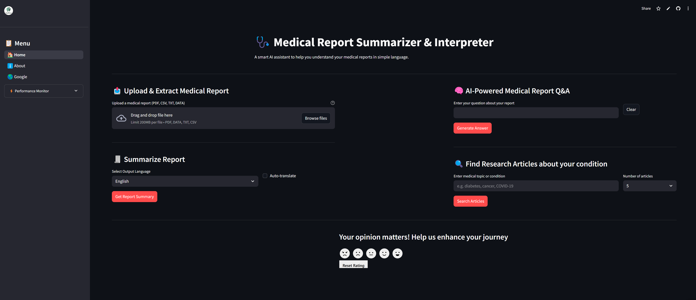

# 🩺 MediMind: Turning Complex Medical Reports into Clear, Human Language
> An AI-powered assistant that transforms medical reports into clarity, insight, and understanding.

Imagine receiving a medical report — pages filled with numbers, terms, and jargon that only a specialist can decode.
Now imagine an AI assistant that reads it for you, simplifies it, answers your questions, and even finds the latest research behind your results.

That’s what MediMind does. 

Built with LangChain, Gemini AI, and Streamlit, MediMind bridges the gap between medical complexity and human understanding.
It’s not just a project — it’s a step toward accessible healthcare communication powered by responsible AI.



---
## 💡 Vision

MediMind was born from a simple idea: medical data should empower, not confuse.  
It combines AI and human empathy to make healthcare information accessible to everyone.

---

## 🚀 Overview

**Medical Report Summarizer & Interpreter** is an advanced AI assistant built using **Streamlit**, **LangChain**, and **Gemini AI**, designed to:

- Extract text from various medical report formats.
- Summarize reports in human-friendly, concise language.
- Translate summaries into multiple languages.
- Answer user questions based on uploaded reports.
- Search for relevant PubMed research articles.
- Monitor app performance in real-time.

This project showcases scalable AI integration, optimized resource management, and accessible healthcare communication.

🔗Try MediMind Live: [Live Demo](https://medimind-mkxu8abkanlfj6czyerb7t.streamlit.app/)
---

## 🌟 What MediMind Can Do

### ✅ Report Upload & Text Extraction
- Uploads files in PDF, TXT, CSV, or custom DATA formats.
- Uses a performance-optimized `CacheOptimizer` for extraction.
- Garbage collection for large files to reduce memory overhead.

### 📝 Smart Summarization
- AI generates 4-line medical report summaries using **Gemini 2.0 Flash** via LangChain.
- Summaries are tailored for non-medical users and professionals alike.
- Supports **auto-translation** to 7+ languages (e.g., Hindi, Telugu, French, German).

### ❓ Medical Q&A Assistant
- Users can ask questions directly about their report.
- Answers are context-aware, AI-generated, and backed by the extracted content.
- Conversational tone with high accuracy, built for both laypeople and experts.

### 🔍 PubMed Research Search
- Users can search for related academic papers by condition/topic.
- Fetches and parses XML abstracts from PubMed APIs.
- Displays top articles with titles, abstracts, and links for in-depth reading.

### ⚡ Performance Monitoring
- Real-time performance tracking using custom decorators.
- Measures execution time for text extraction, summarization, Q&A, and search.
- Optional memory optimization through periodic cache clearing.

### 🌐 Multilingual Support
- Choose from English, Hindi, Telugu, Spanish, French, German, or Chinese.
- Uses Deep Translator with Google API for real-time translation.

### ⭐ User Feedback
- Built-in star rating system to gather user feedback.
- Sentiment-based UI prompts to improve user experience.

---

## 🧩 Tech Stack

| Layer            | Tools Used                                                                 |
|------------------|-----------------------------------------------------------------------------|
| Frontend         | [Streamlit](https://streamlit.io)                                           |
| AI/LLM           | [LangChain](https://www.langchain.com/), Gemini (via `langchain_google_genai`) |
| Translation      | [Deep Translator](https://pypi.org/project/deep-translator/)                |
| Research API     | [PubMed eUtils](https://www.ncbi.nlm.nih.gov/books/NBK25501/)               |
| Performance      | Custom decorators, `gc`, `@st.cache_*` methods                             |
| Environment Mgmt | `.env`, [python-dotenv](https://pypi.org/project/python-dotenv/)           |

---

## ⚙️ How to Run Locally

### 1. Clone the Repository
```bash
https://github.com/Gayatridevi39/MediMind.git
cd MediMind
```

### 2. Set Up Environment
```bash
python -m venv venv
source venv/bin/activate  # On Windows use `venv\Scripts\activate`
pip install -r requirements.txt
```

Create a `.env` file:
```
GEMINI_KEY=your_gemini_api_key_here
```

### 3. Run the App
```bash
streamlit run app/main.py
```

---

## 🧪 Sample Use Cases

- 📄 Summarizing long pathology reports into simple terms.
- ❓ Asking “What does this blood test mean?” and getting context-aware answers.
- 🌐 Exploring academic research for recently diagnosed conditions.
- 🌍 Translating medical findings for multilingual family members.

---

## 🌟 Recognition-Ready Engineering Highlights

- ✅ **LLM Integration**: Gemini 2.0 Flash via LangChain with dynamic prompt templates.
- 🧠 **Modular AI Chains**: Separate summary and Q&A chains for clarity and reusability.
- 🧰 **Performance First**: Smart caching, session-based garbage collection, and execution profiling.
- 🔍 **Real-world NLP**: PDF parsing, text extraction, language translation, and scientific search.
- 🎯 **Recruiter-Friendly Stack**: Practical application of AI + UX + APIs in a deployable Streamlit app.

---
### 🧩 Explore MediMind
👉 [Try the Live App](https://medimind-mkxu8abkanlfj6czyerb7t.streamlit.app/)

---
## 📬 Feedback & Contributions

Your feedback is valued. Contributions, bug reports, or feature ideas are welcome via:

- GitHub Issues & Pull Requests
- Email: [kajulurigayatridevi@gmail.com](kajulurigayatridevi@gmail.com)
- [LinkedIn](https://www.linkedin.com/in/gayatri-devi-kajuluri/)

---

## ⚠️ Disclaimer

MediMind is a **proof-of-concept academic project** developed for educational and research purposes only.  
It is **not intended for clinical use**, diagnosis, or as a substitute for professional medical advice.  
No real patient data is stored, shared, or used in the demo.  
Compliance with regulations such as HIPAA, GDPR, or EMR standards is **not implemented** in this version.  
Users and organizations should independently validate and ensure all regulatory requirements before real-world deployment.

---


